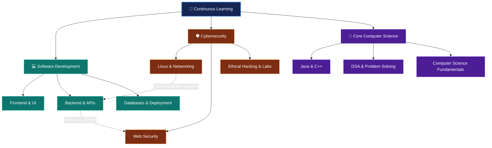
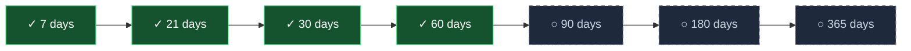
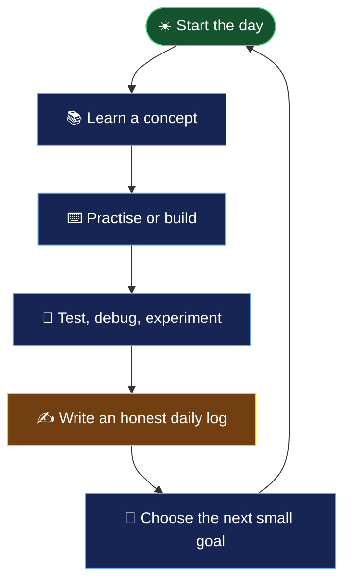
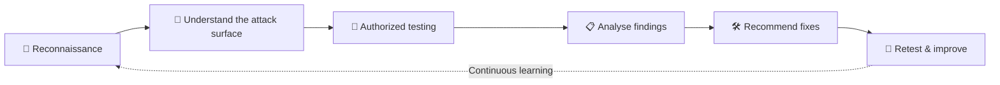

<!--
  ARMAN LEARNING STREAK
  A visual journal of consistency, engineering, and continuous learning.
-->

<div align="center">

# 📓 Arman's Learning Streak

### Building skills. Shipping projects. Showing up every day.

*A public journal of the small steps that compound into meaningful progress.*

[](https://github.com/arman080325)
[](https://www.arman-portfolio.online/)
[](#-progress-dashboard)

> **“Most people overestimate what they can do in a day and underestimate what they can do in a year of consistent days.”**

</div>

---

## ✦ The idea behind this repository

This repository is my public commitment to keep learning, building, experimenting, and documenting the process.

It is not a highlight reel of perfect days. It is a record of the real ones: focused sessions, confusing concepts, debugging, revision, mistakes, experiments, and small wins.

<div align="center">

### The one rule

**One honest progress log every day. Keep the habit alive.**

</div>

Some days will bring substantial code or project progress. Other days may contain only revision, notes, or one lesson learned. The goal is honest consistency—not manufacturing activity to protect a number.

---

## 🧭 My learning map

I'm a B.Tech Computer Science and Engineering student at **Silicon Institute of Technology, Bhubaneswar (2023–2027)**, building experience across software development and cybersecurity.

The map below shows how my learning areas connect.



### 💻 Software development

Learning through the **Apna College Sigma Batch**, project work, documentation, and hands-on practice.

- HTML, CSS, JavaScript, responsive UI development
- React and modern frontend workflows
- Node.js and backend fundamentals
- REST APIs, databases, and full-stack applications
- Git, GitHub, deployment, debugging, and performance

### 🛡️ Cybersecurity and ethical hacking

Learning through the **New Version Hacker (NVH) Ethical Hacking Course**, practical labs, CTF platforms, and independent research.

- Linux and Kali Linux
- Reconnaissance and network analysis
- Web application vulnerabilities and security testing
- Nmap, Wireshark, Burp Suite, Metasploit, and related tools
- Wireless security, digital forensics, and vulnerability analysis
- Responsible disclosure and authorized security testing

### 🧠 Programming and computer science

- Java and data structures / algorithms
- C++ fundamentals and programming practice
- Technical reading, tutorials, and research
- Connecting development concepts with real-world security

<sub>These are learning areas, not claims of professional mastery. The daily logs document the actual work.</sub>

---

## 📊 Progress dashboard

| Metric | Latest verified status |
|---|---:|
| 📅 Journey started | **12 June 2026** |
| 🗓️ Latest daily log commit in the previous verified snapshot | **29 October 2026** |
| 🔥 Consecutive repository log streak in that snapshot | **10 days · 20–29 October 2026** |
| 🏆 Longest GitHub contribution streak | **84 days · 12 June–3 September 2026** |

<sub>The 84-day contribution streak is a separate GitHub-wide metric reported by my portfolio's contribution matrix. It is not the same as the consecutive daily-log streak in this repository. The figures above are the last verified snapshot, not a live counter.</sub>

### 🏁 Milestone trail

A reminder that consistency is built one checkpoint at a time.



- [x] 🟢 **7 days** — One week of showing up.
- [x] 🟡 **21 days** — Three weeks of consistency.
- [x] 🟠 **30 days** — One month of documented progress.
- [x] 🔴 **60 days** — Two months of compounding effort.
- [ ] 🔥 **90 days** — A full quarter of consistency.
- [ ] 💀 **180 days** — Half a year of proof.
- [ ] 👑 **365 days** — One complete year.

Milestones are updated only when supported by the repository history.

---

## 🔄 The daily progress loop

The goal is not to study endlessly. It is to learn something, apply it, reflect, and return with a clearer next step.



### What a useful daily log contains

| Section | What to capture |
|---|---|
| 📚 Learning | What I studied or practised |
| 💡 Understanding | What I can now explain in my own words |
| 🧪 Practical work | Code, projects, labs, or challenges attempted |
| 🧩 Blockers | Mistakes, bugs, and questions to revisit |
| ⏱️ Reflection | Time spent and an honest end-of-day review |
| 🎯 Next step | One concrete priority for tomorrow |

A small, truthful entry is better than a long entry written just to look productive.

---

## 🔬 A security mindset

Development and security are not separate worlds. Understanding how applications are built helps me understand how they can fail—and how to make them stronger.



> *If you can build it, you can break it. If you can break it, you can harden it.*

All security practice belongs in authorized labs, owned systems, or environments where explicit permission has been granted.

---

## 🧰 Projects and practical work

I learn best by building, shipping, testing, and improving real things.

| Project | What it represents |
|---|---|
| [GitAtlas](https://github.com/arman080325/GitAtlas-Project) | GitHub-focused project and developer tooling |
| [CineRoulette](https://github.com/arman080325/cineroulette) | Movie discovery and recommendation application |
| [Full-Stack Travel Platform](https://github.com/arman080325/Full-Stack-Travel-Platform) | Full-stack travel web application |
| [SiteShield Web](https://github.com/arman080325/SiteShield-Web) | Website and security-focused project |
| [DevTrackr](https://github.com/arman080325/DevTrackr-Learning-Progress) | Learning progress and developer tracking |
| [Event Management Project](https://github.com/arman080325/Event-Management-Project) | Event management application |
| [GrabMedia](https://github.com/arman080325/GrabMedia-Project) | Media utility project |
| [SnapURL](https://github.com/arman080325/SnapURL-Project) | URL utility project |
| [Banking Management System](https://github.com/arman080325/Banking-Management-System-Java) | Java application and software fundamentals |
| [Student Management System](https://github.com/arman080325/Student-Management-System-Java-Springboot) | Java and Spring Boot application |

Explore my [GitHub profile](https://github.com/arman080325) for more work. Project names and scopes may evolve as the work develops.

---

## ⚙️ My daily logging workflow

The daily log template is the starting point for each entry. From the repository root:

```bash
# Create today's entry (only if it does not already exist)
mkdir -p logs
touch "logs/$(date +%F).md"

# Review, stage, commit, and push
git status
git add .
git commit -m "log: $(date +%F)"
git push
```

Edit the new file before committing. If the repository's folder layout changes, keep the commands aligned with the actual location of the daily entries. Never overwrite an existing day's log accidentally.

---

## 🌱 On the days I don't feel like it

There will be days when I'm tired, distracted, behind schedule, or stuck on something that should have been simple.

I'll lower the scope before I abandon the habit. I can revise one concept, read documentation, fix one bug, or write a short reflection.

Rest when it is needed. Return without turning one difficult day into a reason to quit.

<div align="center">

### Consistency is not perfection.
### It is the decision to keep returning.

</div>

---

## 🎯 The bigger picture

I want this repository to become a useful record of how I grow as an engineer: from learning fundamentals to building complete applications, from understanding networks to testing software securely, and from following tutorials to solving problems independently.

If someone discovers this repository during a hiring process, I hope the history gives them a genuine view of how I learn and work. But the primary audience remains the person writing the next entry.

**Make the next day count.**

---

## 🔗 Find me online

- 🌐 **Portfolio:** [arman-portfolio.online](https://www.arman-portfolio.online/)
- 💻 **GitHub:** [@arman080325](https://github.com/arman080325)
- 📓 **This repository:** [arman-learning-streak](https://github.com/arman080325/arman-learning-streak)

<div align="center">

*Started on 12 June 2026 · Progress documented one day at a time.*

</div>

<!--
Maintenance notes:
- Refresh the progress snapshot only after checking distinct daily log dates.
- Keep the repository log streak separate from the GitHub-wide contribution streak.
- Tick milestones only when verified by repository history.
- Keep project links aligned with public repositories.
- Do not publish private project details or credentials here.
-->
